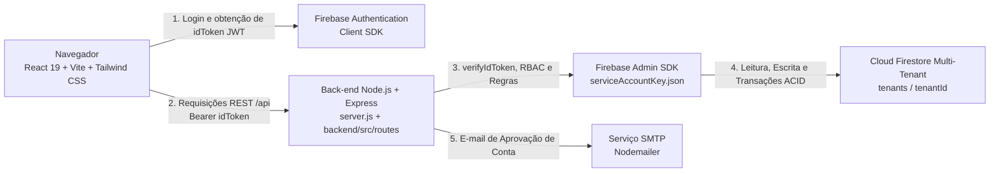

# Estocaí — Gestão Inteligente de Estoque, Produção, PDV e Fidelidade


Sistema Web **Multi-Tenant** em arquitetura **Cliente-Servidor (API REST)** para gestão completa de pequenos estabelecimentos alimentícios e rotisserias (validado em ambiente real com o projeto piloto **Brasinha Rotisseria**). O **Estocaí** substitui comandas e controles manuais em papel por um ecossistema digital integrado cobrindo **Estoque Geral com Lotes e Validade (FEFO)**, **Ordem de Produção por Ficha Técnica**, **Estoque do Dia (PDV)**, **Controle de Expediente de Caixa**, **Cardápio Digital com QR Code** e **Programa de Fidelidade com privacidade LGPD**.

---

## Visão Geral e Arquitetura

O projeto adota estritamente o padrão **Cliente-Servidor com API REST**, centralizando 100% das regras de negócio, validações transacionais (ACID), autorização RBAC e persistência de dados no servidor Express.

- **Front-end (`Frontend/` + camada de interface):** Desenvolvido com **React 19 + Vite + Tailwind CSS** a partir de `Frontend/src/main.jsx`. Atua exclusivamente como **camada de apresentação**, utilizando o **Firebase Client SDK (`firebase/auth`)** apenas para autenticação do usuário e obtenção do `idToken` JWT. Nenhuma leitura ou escrita direta no banco de dados é feita no navegador; toda comunicação ocorre via HTTP (`fetch`) para `/api/...` com o token no cabeçalho `Authorization: Bearer <idToken>`.
- **Back-end (`server.js` + `backend/`):** Servidor **Node.js + Express** responsável por servir os arquivos estáticos compilados (`Frontend/dist`) e expor a API REST `/api/*`. Valida o `idToken` via **Firebase Admin SDK** (`backend/serviceAccountKey.json`), injeta o isolamento de tenant (`req.tenantId`), aplica middlewares **RBAC** (`authMiddleware`, `verificarRole` / `requireRole`), executa transações atômicas (`db.runTransaction`) e dispara notificações por e-mail via **Nodemailer**.



---

## Principais Funcionalidades

### 1. Arquitetura Multi-Tenant
- Isolamento lógico completo por estabelecimento através do identificador `tenantId` (`tenants/{tenantId}`).
- Cada empresa possui suas próprias subcoleções isoladas de `produtos`, `clientes`, `pedidos`, `expedientes`, além de configurações próprias de fidelidade (`config_fidelidade`) e alerta de estoque (`limiar_estoque_minimo`).

### 2. Controle de Acesso Baseado em Funções (RBAC)
Aplicado diretamente nos middlewares do back-end (`backend/src/middlewares/authMiddleware.js`) com bloqueio HTTP `403 Forbidden` para acessos não autorizados:
- **`adm` (`ADMIN`):** Acesso irrestrito a todos os módulos, gestão de usuários/colaboradores, edição/exclusão de clientes, visualização completa de CPF e configuração das regras de fidelidade e estoque mínimo.
- **`repositor` (`ESTOQUISTA`):** Acesso à gestão do inventário, cadastro de insumos e lotes (FEFO), fichas técnicas e execução de ordens de produção (*Produzir Lote*). Bloqueado em PDV, clientes, fidelidade, expediente e configurações gerais.
- **`caixa` (`CAIXA`):** Operação do PDV, abertura e encerramento de expediente, consulta de produtos, cadastro de clientes e lançamento/resgate de fidelidade. Bloqueado para edição/exclusão de inventário, edição/exclusão cadastral de clientes e configurações.

### 3. Fluxo de Aprovação de Contas (Admin Approval Workflow)
- Todo novo cadastro (`/api/auth/register` ou criação via `/api/usuarios`) é inicializado obrigatoriamente no Firestore com `status: 'pendente'` e `aprovado: false`.
- Enquanto estiver pendente, o endpoint `/api/auth/login` e o middleware `authMiddleware` bloqueiam a entrada no sistema com **HTTP `403 Forbidden`**.
- Ao criar a conta, o back-end utiliza o **Nodemailer** (`backend/src/services/emailService.js`) para enviar um e-mail aos fornecedores/administradores (`ADMIN_EMAIL`) contendo os dados do solicitante e um link seguro assinado via **JWT HS256** apontando para `/api/auth/aprovar-usuario`.

### 4. Gestão de Estoque Duplo, Ficha Técnica e Controle FEFO
- **Estoque Geral (`GERAL` — Matéria-Prima):** Gerencia insumos com suporte a múltiplos lotes no array `lotes` (`numeroLote`, `validade`, `quantidade`), mantendo os lotes ordenados automaticamente pela data de vencimento mais próxima (**FEFO — *First Expired, First Out***) e sincronizando o saldo total em `estoque`.
- **Estoque do Dia (`DIA` — Produtos Prontos para Venda):** Produtos exibidos no PDV e no Cardápio Digital, vinculados a uma **Ficha Técnica / Receita** composta pelos insumos do Estoque Geral.
- **Produção em Lote Transacional (`POST /api/produtos/produzir` e `POST /api/estoque-dia/produzir`):** Executa `db.runTransaction()` de forma atômica, validando saldo, dando baixa automática nos lotes do Estoque Geral em ordem **FEFO** (removendo lotes zerados) e somando a quantidade produzida no Estoque do Dia.
- **Alertas de Reestoque:** Comparação no servidor entre o saldo do item e o `limiar_estoque_minimo` configurado para o tenant.

### 5. PDV, Cardápio Digital e Controle de Expediente
- **Ponto de Venda (`POST /api/pedidos`):** Transação ACID que verifica e abate o estoque dos itens vendidos, registra o pedido com forma de pagamento (`PIX`, `DINHEIRO` ou `CARTAO`) e aplica a pontuação de fidelidade quando elegível.
- **Controle de Expediente (`/api/expediente`):** Fluxo de **abertura de caixa** com fundo de troco (`valorInicial`) e **fechamento detalhado** apurando Dinheiro Físico na Gaveta, Cartão (Maquininha) e PIX/Outros, com cálculo automático de sobras ou faltas (discrepâncias) e confirmação explícita em caso de divergência.
- **Cardápio Web & QR Code (`cardapio.html`):** Página pública consumindo `GET /api/produtos/public/:tenantId` para exibir os itens disponíveis no Estoque do Dia do estabelecimento.

### 6. Programa de Fidelidade e Privacidade (LGPD)
- Regras configuráveis pelo administrador por tenant: status ativo/inativo, valor mínimo do pedido para pontuar (`valor_minimo_ponto`), meta de compras (`meta_compras_premio`) e descrição do prêmio (`descricao_premio`).
- **Mascaramento de CPF no Back-end:** Na serialização da API (`/api/clientes`), o CPF é mascarado no servidor no formato `***.456.789-**` para perfis não administradores (`caixa`), impedindo exposição de dados sensíveis no tráfego de rede e na interface.

---

## Tecnologias Utilizadas

Versões verificadas diretamente nos arquivos `Frontend/package.json` e `backend/package.json`:

### Front-end (`Frontend/`)
| Tecnologia | Versão | Função |
| :--- | :--- | :--- |
| **React / React DOM** | `^19.2.8` | Biblioteca de interface e camada de apresentação |
| **Vite** | `^8.3.0` | Bundler, servidor de desenvolvimento e proxy `/api` |
| **React Router DOM** | `^7.18.4` | Roteamento no front-end |
| **Tailwind CSS** | `^3.4.19` | Estilização utilitária e responsividade |
| **Firebase Client SDK** | `^13.0.0` | Autenticação no cliente e geração do `idToken` JWT |
| **Lucide React** | `^1.52.0` | Ícones de interface |
| **Oxlint** | `^1.81.0` | Análise estática e linting |

### Back-end (`server.js` e `backend/`)
| Tecnologia | Versão | Função |
| :--- | :--- | :--- |
| **Node.js + Express** | `^4.21.2` | API REST e servidor de arquivos estáticos (`Frontend/dist`) |
| **Firebase Admin SDK** | `^13.1.0` | Validação JWT (`verifyIdToken`), Auth e Firestore |
| **Nodemailer** | `^10.5.0` | Disparo de e-mails transacionais de aprovação de contas |
| **CORS** | `^2.8.5` | Controle de compartilhamento de recursos entre origens |
| **Dotenv** | `^16.4.7` | Carregamento de variáveis de ambiente |

---

## Estrutura de Pastas

```text
Estocai/
├── server.js                        # Ponto de entrada do servidor Express (API REST + build React)
├── index.html                       # Documento HTML base da aplicação
├── app.js                           # Controlador de eventos da UI consumindo exclusivamente /api/*
├── style.css                        # Estilos globais complementares
├── cardapio.html                    # Cardápio Digital público (por tenant via query string)
├── firestore.rules                  # Regras de segurança do Cloud Firestore
├── iniciar-site.bat                 # Atalho Windows para iniciar o servidor e abrir o navegador
├── Assets/                          # Documentação acadêmica, Business Model, Personas e diagramas
├── backend/
│   ├── package.json                 # Dependências e script de inicialização do back-end
│   ├── serviceAccountKey.json       # Credencial privada do Firebase Admin SDK (não versionar)
│   ├── firestore-data.json          # Persistência local JSON compatível com transações do Firestore
│   └── src/
│       ├── config/
│       │   └── firebase.js          # Inicialização do Firebase Admin SDK e camada de persistência
│       ├── middlewares/
│       │   └── authMiddleware.js    # Validação de JWT, bloqueio pendente, tenantId e RBAC
│       ├── services/
│       │   └── emailService.js      # Geração de JWT de aprovação e envio de e-mail via Nodemailer
│       └── routes/
│           ├── authRoutes.js        # Login, registro, aprovação por e-mail e perfil (/me)
│           ├── produtosRoutes.js    # CRUD Estoque Geral/Dia, FEFO e produção de lote
│           ├── estoqueDiaRoutes.js  # Rota dedicada de produção de lote no Estoque do Dia (FEFO)
│           ├── clientesRoutes.js    # CRUD de clientes, mascaramento de CPF (LGPD) e fidelidade
│           ├── pedidosRoutes.js     # Registro de vendas PDV com transação ACID
│           ├── usuariosRoutes.js    # Gestão de colaboradores (exclusivo ADMIN)
│           ├── configuracoesRoutes.js # Regras de fidelidade e limiar mínimo de estoque
│           └── expedientesRoutes.js # Abertura e fechamento de caixa com apuração por pagamento
└── Frontend/
    ├── package.json                 # Dependências e scripts React + Vite + Tailwind CSS
    ├── vite.config.js               # Proxy de desenvolvimento (/api -> http://localhost:3000)
    ├── index.html                   # Entrada HTML do Vite
    ├── public/                      # Assets estáticos servidos no build
    └── src/
        ├── main.jsx                 # Ponto de entrada React 19
        ├── App.jsx                  # Componente raiz conectado ao layout e estados do modal
        ├── firebase.js              # Inicialização exclusiva do Firebase Auth no cliente
        ├── layoutHtml.js            # Template HTML sincronizado para renderização React
        ├── context/
        │   └── AuthContext.jsx      # Contexto de autenticação JWT
        ├── services/
        │   └── api.js               # Cliente HTTP fetch centralizado enviando Bearer idToken
        └── components/
            └── EstoqueModule.jsx    # Módulo React de inventário, entrada de lotes FEFO e produção
```

---

## Como Executar o Projeto Localmente

### Pré-requisitos
- **Node.js** (v18+ ou v20+ recomendado) e **npm**.
- Conta no **Firebase** com **Authentication** (E-mail/Senha) e **Cloud Firestore** habilitados.
- Chave de conta de serviço do Firebase Admin (`serviceAccountKey.json`) e, opcionalmente, credenciais SMTP (ex.: Gmail App Password) para disparo real de e-mails de aprovação.

### 1. Instalação das Dependências

Instale as dependências do back-end e do front-end separadamente (não há `package.json` na raiz):

```bash
# 1. Instalar dependências do Back-end
cd backend
npm install

# 2. Instalar dependências do Front-end
cd ../Frontend
npm install
```

### 2. Configuração de Variáveis de Ambiente (`.env`) e Firebase Admin

1. Baixe a chave privada da sua conta de serviço no **Console do Firebase** (*Configurações do Projeto > Contas de Serviço > Gerar nova chave privada*) e salve-a exatamente em:
   ```text
   backend/serviceAccountKey.json
   ```
2. Crie um arquivo `.env` na raiz do projeto (e/ou em `backend/.env`) seguindo o modelo abaixo, **sem versionar senhas reais**:

```env
# Porta do servidor Express
PORT=3000

# E-mail dos administradores/fornecedores que recebem solicitações de aprovação de conta
ADMIN_EMAIL=seu-email-admin@exemplo.com

# Configuração SMTP para o Nodemailer (ex: Gmail com Senha de App)
SMTP_SERVICE=gmail
SMTP_HOST=smtp.gmail.com
SMTP_PORT=587
SMTP_USER=seu-remetente@gmail.com
SMTP_PASS=sua-senha-de-aplicativo-smtp

# Opcionais
# APP_BASE_URL=http://localhost:3000
# APPROVAL_JWT_SECRET=sua-chave-secreta-para-links-de-aprovacao
# SUPER_ADMIN_KEY=chave-opcional-para-aprovacao-administrativa
```

> **Nota:** Caso `SMTP_USER` e `SMTP_PASS` não sejam preenchidos, o `emailService.js` utiliza automaticamente o fallback `jsonTransport` do Nodemailer e imprime o link de aprovação no console do servidor para testes locais.

### 3. Executando em Desenvolvimento e Produção

#### Modo Produção Integrado (Build React + Express na porta 3000)
Gera o bundle otimizado do React em `Frontend/dist/` e inicia o servidor Express servindo a API e o front-end juntos:

```bash
# 1. Gerar o build de produção do Front-end
cd Frontend
npm run build

# 2. Iniciar o servidor Express (a partir da raiz ou da pasta backend/)
cd ..
node server.js
# Ou via pasta backend:
# cd backend && npm start
```

> No **Windows**, após gerar o build, você também pode executar diretamente o arquivo **`iniciar-site.bat`** na raiz para subir o servidor e abrir `http://localhost:3000` automaticamente.

#### Modo Desenvolvimento (Hot Reload com Vite + Proxy para API Express)
Para desenvolver alterações no React com recarregamento instantâneo:

```bash
# Terminal 1 — Subir a API REST do Express na porta 3000
node server.js

# Terminal 2 — Subir o servidor de desenvolvimento Vite (com proxy /api -> localhost:3000)
cd Frontend
npm run dev
```

- **Painel Principal:** `http://localhost:3000/` (ou porta exibida pelo Vite em modo `dev`)
- **Cardápio Digital:** `http://localhost:3000/cardapio.html?tenant=<SEU_TENANT_ID>`
- **Base da API REST:** `http://localhost:3000/api`

---

## Resumo das Rotas da API REST

Todas as rotas autenticadas exigem o cabeçalho `Authorization: Bearer <idToken>` validado via Firebase Admin SDK (`authMiddleware`).

### Autenticação e Aprovação (`/api/auth`)
| Método | Rota | Descrição | Perfis Permitidos |
| :--- | :--- | :--- | :--- |
| `POST` | `/api/auth/login` | Valida o `idToken`, verifica aprovação (`403` se `pendente`) e retorna dados da sessão | Público (com `idToken` Firebase) |
| `POST` | `/api/auth/register` | Cria tenant e usuário com `status: 'pendente'` e envia e-mail de aprovação | Público (com `idToken` Firebase) |
| `GET` / `POST` / `PUT` | `/api/auth/aprovar-usuario` | Altera o status da conta de `pendente` para `aprovado` | Token JWT do e-mail ou Super-Admin |
| `GET` | `/api/auth/me` | Retorna o perfil autenticado e tenant vinculado | `adm`, `repositor`, `caixa` |

### Produtos, Lotes FEFO e Produção (`/api/produtos` e `/api/estoque-dia`)
| Método | Rota | Descrição | Perfis Permitidos |
| :--- | :--- | :--- | :--- |
| `GET` | `/api/produtos/public/:tenantId` | Lista itens ativos do Estoque do Dia para o Cardápio Web | Público |
| `GET` | `/api/produtos` | Lista produtos/insumos com alertas de reestoque e lotes FEFO | `adm`, `repositor`, `caixa` |
| `GET` | `/api/produtos/:id` | Busca detalhes de um item específico | `adm`, `repositor`, `caixa` |
| `POST` | `/api/produtos` | Cadastra produto (`DIA`) ou insumo/lote (`GERAL`) ordenado por FEFO | `adm`, `repositor` |
| `PUT` | `/api/produtos/:id` | Atualiza produto, ficha técnica ou dá entrada em novo lote FEFO | `adm`, `repositor` |
| `DELETE` | `/api/produtos/:id` | Remove um item do inventário | `adm`, `repositor` |
| `POST` | `/api/produtos/produzir` | Produz lote em transação ACID com baixa automática por **FEFO** no Estoque Geral | `adm`, `repositor` |
| `POST` | `/api/estoque-dia/produzir` | Endpoint alternativo de produção de lote com baixa automática por **FEFO** | `adm`, `repositor` |

### Vendas / PDV (`/api/pedidos`)
| Método | Rota | Descrição | Perfis Permitidos |
| :--- | :--- | :--- | :--- |
| `GET` | `/api/pedidos` | Lista os pedidos do estabelecimento | `adm`, `caixa` |
| `POST` | `/api/pedidos` | Registra venda em transação ACID, dá baixa no estoque e pontua fidelidade | `adm`, `caixa` |

### Clientes e Fidelidade (`/api/clientes` e `/api/fidelidade`)
| Método | Rota | Descrição | Perfis Permitidos |
| :--- | :--- | :--- | :--- |
| `GET` | `/api/clientes` | Lista clientes (CPF puro para `adm`; CPF mascarado para `caixa`) | `adm`, `caixa` |
| `GET` | `/api/clientes/:id` | Busca dados de um cliente (com mascaramento LGPD para `caixa`) | `adm`, `caixa` |
| `POST` | `/api/clientes` | Cadastra novo cliente no programa de fidelidade | `adm`, `caixa` |
| `POST` | `/api/clientes/:id/compra` | Soma `+1` compra válida e verifica elegibilidade ao prêmio | `adm`, `caixa` |
| `POST` | `/api/clientes/:id/resgatar` | Valida a meta e registra o resgate do prêmio de fidelidade | `adm`, `caixa` |
| `PUT` | `/api/clientes/:id` | Edita dados cadastrais e pontuação do cliente | `adm` |
| `DELETE` | `/api/clientes/:id` | Exclui o cadastro de um cliente | `adm` |

### Controle de Expediente / Caixa (`/api/expediente` e `/api/expedientes`)
| Método | Rota | Descrição | Perfis Permitidos |
| :--- | :--- | :--- | :--- |
| `GET` | `/api/expediente/atual` | Retorna status do caixa (`aberto`/`fechado`) e totais por meio de pagamento | `adm`, `caixa` |
| `GET` | `/api/expediente` | Lista o histórico de expedientes do tenant | `adm`, `caixa` |
| `POST` | `/api/expediente/iniciar` | Inicia o expediente registrando o fundo de troco inicial | `adm`, `caixa` |
| `POST` | `/api/expediente/encerrar` | Fecha o caixa conferindo Dinheiro, Cartão e PIX e apurando discrepâncias | `adm`, `caixa` |

### Usuários e Configurações (`/api/usuarios` e `/api/configuracoes`)
| Método | Rota | Descrição | Perfis Permitidos |
| :--- | :--- | :--- | :--- |
| `GET` | `/api/usuarios` | Lista os colaboradores vinculados ao tenant | `adm` |
| `GET` | `/api/usuarios/:id` | Busca detalhes de um colaborador do tenant | `adm` |
| `POST` | `/api/usuarios` | Cria colaborador no Firebase Auth + Firestore (`pendente`) e envia e-mail | `adm` |
| `PUT` | `/api/usuarios/:id` | Atualiza dados, cargo, status ou senha do colaborador | `adm` |
| `DELETE` | `/api/usuarios/:id` | Remove o colaborador do Firestore e do Firebase Auth | `adm` |
| `GET` | `/api/configuracoes/fidelidade` | Obtém as regras atuais do programa de fidelidade do tenant | `adm`, `caixa` |
| `PUT` | `/api/configuracoes/fidelidade` | Atualiza meta de compras, valor mínimo, prêmio e status da fidelidade | `adm` |
| `GET` | `/api/configuracoes/estoque` | Obtém o limiar mínimo de alerta de reestoque | `adm`, `repositor`, `caixa` |
| `PUT` | `/api/configuracoes/estoque` | Define o limiar mínimo global para alertas de reestoque | `adm` |

---

## Autores e Licença

### Autores
Desenvolvido como projeto acadêmico Open Source (**Fatec Sorocaba**) em parceria com a **Brasinha Rotisseria**:
- **Murilo Garbo**
- **Vinícius Holtz**

### Licença
Este projeto é de código aberto (Open Source) para fins educacionais e de apoio a pequenos estabelecimentos comerciais. Caso deseje utilizar, adaptar ou distribuir comercialmente, consulte os autores do repositório.
